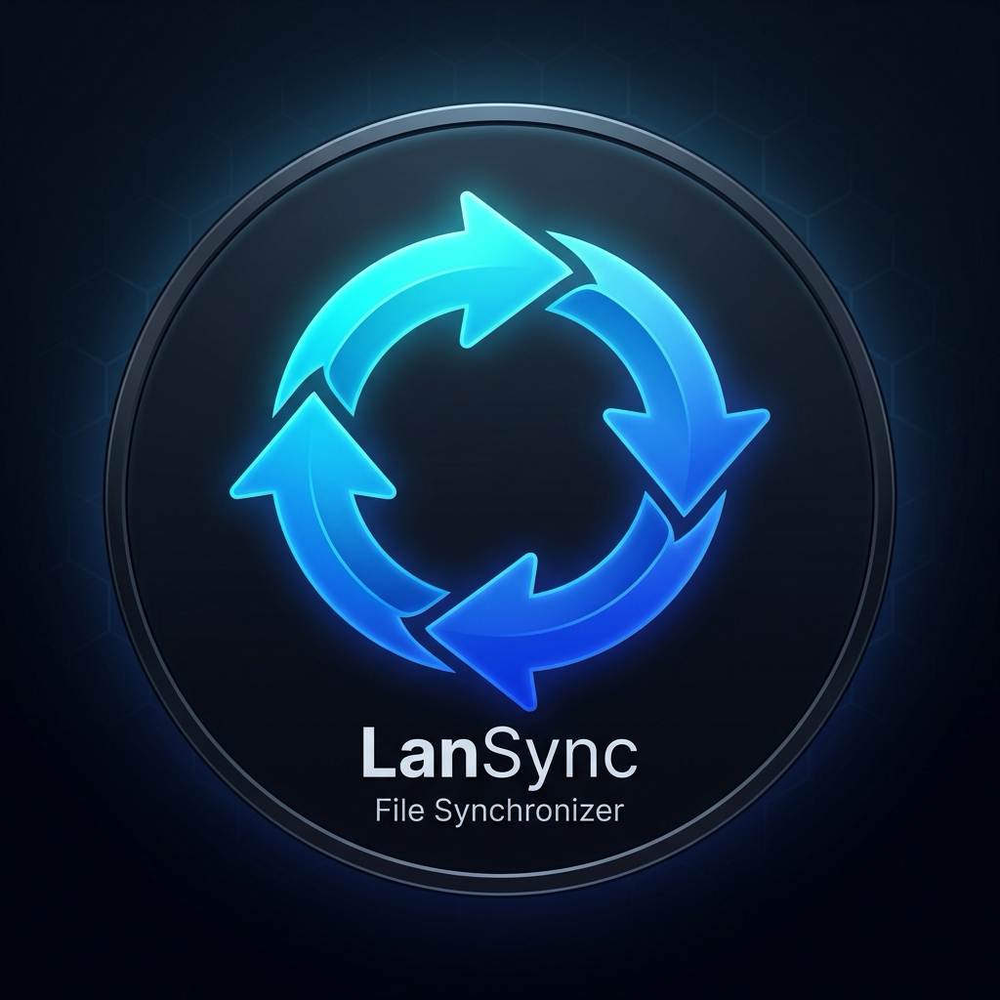
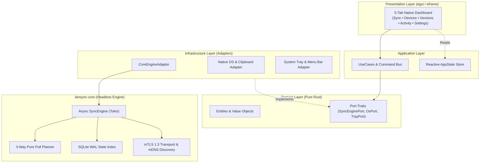
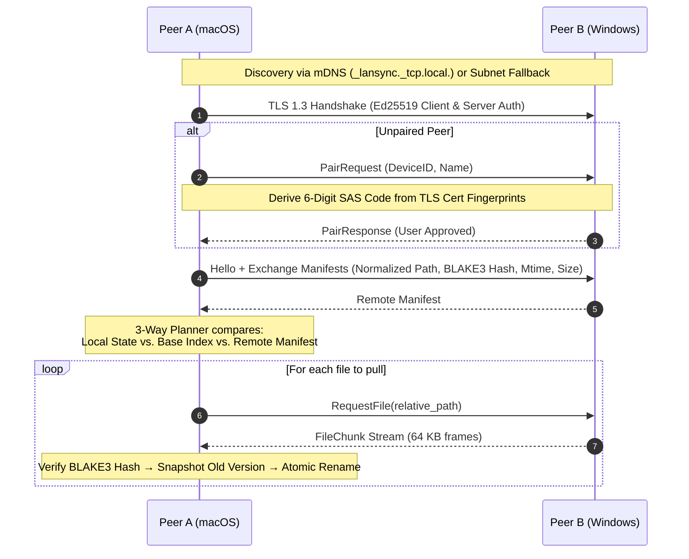

<div align="center">



# LanSync

**High-performance, zero-cloud, peer-to-peer (P2P) two-way file synchronizer for Local Area Networks.**  
Built in pure Rust for seamless synchronization between **macOS** and **Windows**.

[](https://www.rust-lang.org/)
[](https://github.com/ImNgManhDung/lansync)
[](https://github.com/ImNgManhDung/lansync)
[](https://github.com/emilk/egui)
[](https://github.com/ImNgManhDung/lansync)
[](https://github.com/ImNgManhDung/lansync/releases/latest)
[](LICENSE)

[**Overview**](#overview) •
[**Why LanSync?**](#why-lansync) •
[**Key Features**](#key-features) •
[**Architecture**](#architecture--sync-protocol) •
[**Quick Start**](#getting-started) •
[**Security & Safety**](#security--safety-guarantees) •
[**Project Structure**](#project-structure)

</div>

---

## Overview

**LanSync** is a lightweight, offline-first continuous file synchronization engine and native desktop client written in 100% Rust. It turns any folder on your **macOS** and **Windows** machines into a real-time, two-way synchronized workspace over local Wi-Fi or Ethernet—**with zero cloud servers, zero accounts, and zero internet dependency**.

Built as a single native binary powered by `tokio`, `rustls`, `rusqlite`, and `egui`, LanSync consumes **~15 MB of RAM** while saturating gigabit LAN speeds.

---

## Why LanSync?

| Capability | **LanSync** |
| :--- | :--- |
| **100% Offline / LAN-Only** | Yes — Direct peer-to-peer over Wi-Fi / Ethernet without internet |
| **Continuous 2-Way Folder Sync** | Automatic real-time synchronization |
| **Cross-Platform (macOS ↔ Windows)** | First-class support with automatic Unicode & path harmonization |
| **Safe Deletion Protection (No Accidental Wipe)** | **Built-in Rule #1** (`Never`, `Ask`, or `MirrorTrash` modes) |
| **UI Technology & Memory Overhead** | **Native `egui` (~15 MB RAM)** |
| **Zero-Config LAN Discovery** | Automatic mDNS + TCP Subnet Scan fallback |

---

## Key Features

- **Real-Time Two-Way Synchronization** — Powered by a debounced filesystem watcher (`notify`) and a deterministic 3-way reconciliation planner. Adding or updating a file on one machine instantaneously streams it to all paired peers.
- **Safety Rule #1 (Anti-Data-Loss Deletion Policy)** — Deleting a file on Machine A **never** deletes it on Machine B by default. Configurable per-peer or globally (`Never`, `Ask`, or `MirrorTrash`).
- **Lossless Conflict Resolution** — Concurrent edits on disconnected machines never overwrite each other. Both versions are preserved automatically using deterministic conflict naming: `filename (conflict-<device> YYYY-MM-DD HHMM).ext`.
- **Mutual TLS 1.3 (mTLS) & 6-Digit Pairing** — Every peer generates an Ed25519 identity certificate. Connections use strict mutual TLS 1.3 authenticated via a symmetric 6-digit Short Authentication String (SAS) confirmation code on first pairing.
- **Zero-Config mDNS & Subnet Fallback Discovery** — Automatically discovers peers on `_lansync._tcp.local.` with an active TCP subnet scanner fallback for restrictive router/VLAN environments.
- **Cross-OS Filesystem Harmonization** — Transparently normalizes macOS NFD decomposed Unicode filenames into standard Unicode NFC, detects case-insensitive path collisions, and filters out OS noise (`.DS_Store`, `Thumbs.db`, `~$*`, `.lansync-*`).
- **Built-in File Versioning** — Prior to overwriting any modified file, LanSync snapshots the previous version into `.lansync-versions/` for one-click local recovery from the GUI.
- **Pure Rust Native GUI & System Tray** — Built with `egui`/`eframe`, `tray-icon`, and `muda` following strict **Clean Architecture** principles. Supports close-to-tray background operation on both macOS Menu Bar and Windows System Tray.

---

## Architecture & Sync Protocol

LanSync is architected as a modular Cargo workspace separating the headless synchronization engine (`lansync-core`) from the native desktop application (`lansync-tray`).

### 1. Clean Architecture (`lansync-tray` & `lansync-core`)



### 2. P2P Handshake & Pull-Only Synchronization Flow



---

## Security & Safety Guarantees

| Mechanism | Technical Implementation |
| :--- | :--- |
| **Transport Encryption** | TLS 1.3 only via `rustls` (`ring` crypto provider) with mutual client/server certificate verification (`Ed25519`). |
| **Device Identity** | Luhn-protected Base32 Device ID derived from the SHA-256 fingerprint of the node's Ed25519 public key certificate. |
| **MITM Protection** | Symmetric 6-digit pairing verification code derived deterministically from sorted peer certificate hashes. |
| **Atomic File Writes** | Incoming streams write to `.lansync-tmp-<uuid>`, verify full-file **BLAKE3** cryptographic checksums, restore `mtime`, and execute an atomic filesystem rename. |
| **State Durability** | Local baseline state persisted in **SQLite (WAL mode)** for crash-resilient 3-way merge planning. |

---

## Getting Started

### Option A: Download Pre-built Installers (Recommended)

Download the latest native binary from [**GitHub Releases**](https://github.com/ImNgManhDung/lansync/releases/latest) — no Rust installation required:

| Operating System | Architecture | Installer / Binary |
| :--- | :--- | :--- |
| **macOS 12+** | Universal (Apple Silicon & Intel) | `LanSync-macos-universal.dmg` |
| **Windows 10 / 11** | 64-bit (`x86_64`) | `LanSync-windows-x64.exe` |

---

### Option B: Build from Source

#### Prerequisites

- **Rust Toolchain**: `1.85+` (Edition 2024 supported — install via [rustup.rs](https://rustup.rs))
- **OS**: macOS 12+ (Apple Silicon / Intel) or Windows 10/11

#### 1. Clone & Run the Native Desktop App

```bash
git clone https://github.com/ImNgManhDung/lansync.git
cd lansync

# Launch the native GUI & System Tray application
cargo run --release -p lansync-tray
```

- Opens the **LanSync Desktop Dashboard** (`820×560`) and registers an icon in the **macOS Menu Bar** or **Windows System Tray**.
- Clicking the window close button (`X`) hides the dashboard to the system tray while background synchronization continues uninterrupted.

### 2. Run the Automated Test Suite

```bash
cargo test --workspace
```

### 3. Multi-Node CLI Simulation (Single Machine)

Simulate a macOS node and a Windows node syncing locally in two terminal sessions:

**Terminal 1 — Node A (`MacBook-Pro`):**
```bash
cargo run -p lansync-core --example dev -- \
  --name "MacBook-Pro" \
  --dir ./test_folders/mac \
  --data ./test_data/mac \
  --port 42424
```

**Terminal 2 — Node B (`Windows-PC`):**
```bash
cargo run -p lansync-core --example dev -- \
  --name "Windows-PC" \
  --dir ./test_folders/win \
  --data ./test_data/win \
  --port 42425
```

### 4. Syncing Between Real macOS & Windows Machines on LAN

1. Connect both computers to the same Wi-Fi or Ethernet network.
2. Run `cargo run --release -p lansync-tray` on both machines.
3. Open the **Thiết bị (Devices)** tab — both devices will appear automatically via mDNS (or click **Thêm theo IP** if your router blocks multicast).
4. Click **Ghép đôi (Pair)**, verify that the **6-digit security code** matches on both screens, and click **Chấp nhận (Approve)**.
5. Drop any file into your synchronized folder and watch it appear on the other machine in real time.

---

## Project Structure

```text
lansync/
├── Cargo.toml                                  # Workspace manifest (Edition 2024)
├── crates/
│   └── lansync-core/                           # Core P2P synchronization engine library
│       ├── src/
│       │   ├── config.rs                       # Persistent JSON configuration & policy settings
│       │   ├── discovery.rs                    # mDNS (_lansync._tcp.local.) & subnet scanner
│       │   ├── engine.rs                       # Unified async orchestrator & peer session loop
│       │   ├── fsutil.rs                       # Fast BLAKE3 hashing & mtime preservation
│       │   ├── identity.rs                     # Ed25519 certificate generation & DeviceId
│       │   ├── index.rs                        # SQLite WAL index & filesystem scan delta
│       │   ├── pairing.rs                      # 6-digit SAS derivation & trusted PeerStore
│       │   ├── paths.rs                        # Unicode NFC normalization & OS ignore filters
│       │   ├── planner.rs                      # Deterministic 3-way pull-only sync planner
│       │   ├── protocol.rs                     # Length-prefixed Bincode wire protocol frames
│       │   ├── transfer.rs                     # Chunked streaming & atomic temp-file commit
│       │   ├── transport.rs                    # Mutual TLS 1.3 client/server verifier
│       │   ├── versioning.rs                   # Local snapshot archival (.lansync-versions/)
│       │   └── watcher.rs                      # Debounced cross-platform file watcher
│       ├── tests/
│       │   ├── sync.rs                         # End-to-end integration & conflict test suite
│       │   └── unit.rs                         # Core unit test suite
│       └── examples/
│           └── dev.rs                          # Interactive headless CLI test harness
└── apps/
    └── lansync-tray/                           # Native Desktop GUI & System Tray App
        ├── icons/                              # High-DPI app & tray icons (.png, .ico)
        ├── tests/
        │   └── unit.rs                         # Application & domain unit tests
        └── src/
            ├── lib.rs                          # Library crate root
            ├── main.rs                         # Composition Root (wires DI, Tokio & eframe)
            ├── domain/                         # Layer 1: Pure business models & port traits
            │   ├── models.rs
            │   └── ports.rs
            ├── application/                    # Layer 2: Use cases, commands & UI state store
            │   ├── commands.rs
            │   ├── state.rs
            │   └── use_cases.rs
            ├── infrastructure/                 # Layer 3: Core engine, OS & system tray adapters
            │   ├── core_adapter.rs
            │   ├── os_adapter.rs
            │   └── tray_adapter.rs
            └── presentation/                   # Layer 4: Immediate-mode egui views & custom theme
                ├── mod.rs
                ├── theme.rs
                └── tabs/
                    ├── sync_tab.rs             # Folder status, metrics & quick actions
                    ├── devices_tab.rs          # LAN discovery, 6-digit pairing & manual IP
                    ├── versions_tab.rs         # Snapshot browser & 1-click file restore
                    ├── activity_tab.rs         # Real-time transfer & conflict audit log
                    └── settings_tab.rs         # Deletion policies, ignore rules & diagnostics
```

---

## Tech Stack

| Category | Crate / Technology | Purpose |
| :--- | :--- | :--- |
| **Async Runtime** | `tokio`, `tokio-util` | Non-blocking I/O, TCP streams, timers, and task orchestration |
| **Cryptography & TLS** | `rustls`, `tokio-rustls`, `rcgen`, `ring` | Mutual TLS 1.3 transport & self-signed Ed25519 certificates |
| **Hashing** | `blake3`, `sha2` | High-speed content addressing & certificate fingerprinting |
| **Database** | `rusqlite` (bundled) | Embedded SQLite in WAL mode for 3-way sync state indexing |
| **LAN Discovery** | `mdns-sd`, `if-addrs`, `socket2` | Zero-configuration multicast DNS & subnet TCP fallback |
| **Filesystem** | `notify-debouncer-full`, `walkdir`, `filetime` | Real-time FS events, recursive traversal, and `mtime` sync |
| **Wire Protocol** | `serde`, `bincode`, `unicode-normalization` | Compact binary framing & macOS/Windows Unicode NFC normalization |
| **Native GUI & Tray** | `egui`, `eframe`, `tray-icon`, `muda`, `rfd` | Immediate-mode native GUI, system tray menu, and native file dialogs |

---

## Contributing

Contributions, issues, and feature requests are welcome!

1. Fork the repository and create your feature branch (`git checkout -b feat/amazing-feature`).
2. Verify all unit and integration tests pass (`cargo test --workspace`).
3. Ensure code formatting and lints are clean (`cargo fmt --check && cargo clippy --workspace`).
4. Open a Pull Request describing your changes.

---

## License

Distributed under the **MIT License**. See `LICENSE` for more information.
