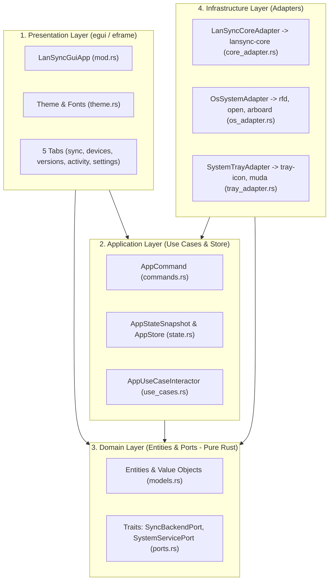

# Thiết kế Kiến trúc: Chuyển đổi `apps/lansync-tray` sang Rust Native GUI (`egui`) theo Clean Architecture

> Ngày: 2026-10-17
> Phạm vi: Thay thế hoàn toàn Tauri v2 + HTML/CSS/JS trong `apps/lansync-tray` bằng ứng dụng Rust Native GUI (`eframe`/`egui` + `tray-icon`), tổ chức theo **Clean Architecture (4 tầng: `domain`, `application`, `infrastructure`, `presentation`)**, giữ nguyên 100% cấu trúc của `crates/lansync-core`.

---

## 1. Nguyên lý Clean Architecture trong `apps/lansync-tray`



### Quy tắc phụ thuộc (Dependency Rule):
1. **`domain/` (Tầng trong cùng)**:
   - Không phụ thuộc vào `egui`, `tray-icon`, hay `lansync-core`.
   - Chứa các Entities/Models thuần (`PeerEntity`, `ConflictEntity`, `ActivityEntity`, `PendingPairingEntity`, `PendingDeletionEntity`, `VersionSnapshotEntity`, `DeletePolicy`) và các **Ports (Traits)**: `SyncBackendPort`, `SystemServicePort`.
2. **`application/` (Tầng điều phối nghiệp vụ UI)**:
   - Chỉ phụ thuộc vào `domain/`.
   - Chứa `AppStateSnapshot` (trạng thái đọc tức thì cho UI), `AppCommand` (các mệnh lệnh từ người dùng), và `AppUseCaseInteractor` (xử lý lệnh và sự kiện nền).
3. **`infrastructure/` (Tầng công cụ & tích hợp ngoài)**:
   - Triển khai các trait của `domain/` để kết nối với `lansync-core` (`core_adapter.rs`), hệ điều hành (`os_adapter.rs`: mở Finder/Explorer, hộp thoại chọn thư mục, clipboard), và khay hệ thống (`tray_adapter.rs`: `tray-icon` + `muda`).
4. **`presentation/` (Tầng hiển thị `egui` / `eframe`)**:
   - Chỉ đọc `AppStateSnapshot` từ `application/` và gửi `AppCommand` qua channel bất đồng bộ. Không bao giờ gọi trực tiếp `lansync-core` hay chạy tác vụ I/O chặn khung hình.

---

## 2. Cấu trúc Thư mục Chi tiết (`apps/lansync-tray`)

```text
apps/lansync-tray/
├── Cargo.toml
├── icons/
│   ├── 32x32.png
│   ├── 128x128.png
│   ├── icon.png
│   └── icon.ico
└── src/
    ├── main.rs                      # Composition Root: khởi tạo Adapters, UseCaseWorker, SystemTray và eframe
    ├── domain/
    │   ├── mod.rs
    │   ├── models.rs                # Entities, Value Objects & pure logic (derive_original_from_conflict, format_bytes)
    │   └── ports.rs                 # Traits: SyncBackendPort, SystemServicePort, BackendEvent
    ├── application/
    │   ├── mod.rs
    │   ├── commands.rs              # Enum AppCommand đại diện cho mọi Use Case người dùng kích hoạt
    │   ├── state.rs                 # AppStateSnapshot & AppStore (Arc<RwLock<AppStateSnapshot>>)
    │   └── use_cases.rs             # AppUseCaseInteractor: xử lý AppCommand, BackendEvent & cập nhật AppStore
    ├── infrastructure/
    │   ├── mod.rs
    │   ├── core_adapter.rs          # Triển khai SyncBackendPort kết nối với lansync_core::SyncEngine
    │   ├── os_adapter.rs            # Triển khai SystemServicePort (open folder, rfd dialog, arboard clipboard, local IP)
    │   └── tray_adapter.rs          # Quản lý System Tray (tray-icon + muda menu) trên macOS & Windows
    └── presentation/
        ├── mod.rs                   # LanSyncGuiApp (eframe::App): Sidebar, Pairing Banner, Window Close-to-Tray
        ├── theme.rs                 # Nạp font tiếng Việt (macOS/Windows) & bảng màu Dark Slate
        └── tabs/
            ├── mod.rs
            ├── sync_tab.rs          # Tab 1: Đồng bộ
            ├── devices_tab.rs       # Tab 2: Thiết bị
            ├── versions_tab.rs      # Tab 3: Phiên bản
            ├── activity_tab.rs      # Tab 4: Lịch sử
            └── settings_tab.rs      # Tab 5: Cài đặt
```

---

## 3. Tương thích Đa nền tảng (macOS & Windows)
- **Phông chữ Tiếng Việt (UTF-8)**: `presentation/theme.rs` tự động nạp font hệ thống hỗ trợ đầy đủ dấu tiếng Việt trên macOS (`Arial.ttf` / `Helvetica.ttc`) và Windows (`segoeui.ttf` / `arial.ttf`).
- **System Tray & Ẩn cửa sổ khi đóng (`X`)**:
  - `presentation/mod.rs` bắt sự kiện `close_requested()` của cửa sổ: nếu không phải lệnh thoát từ menu Tray, ứng dụng gửi `ViewportCommand::CancelClose` và `ViewportCommand::Visible(false)` để tiếp tục đồng bộ ngầm dưới khay hệ thống.
  - Nhấp chuột vào icon Tray hoặc chọn *"Hiện bảng điều khiển"* trên menu chuột phải sẽ đánh thức và đưa cửa sổ lên trên cùng.
